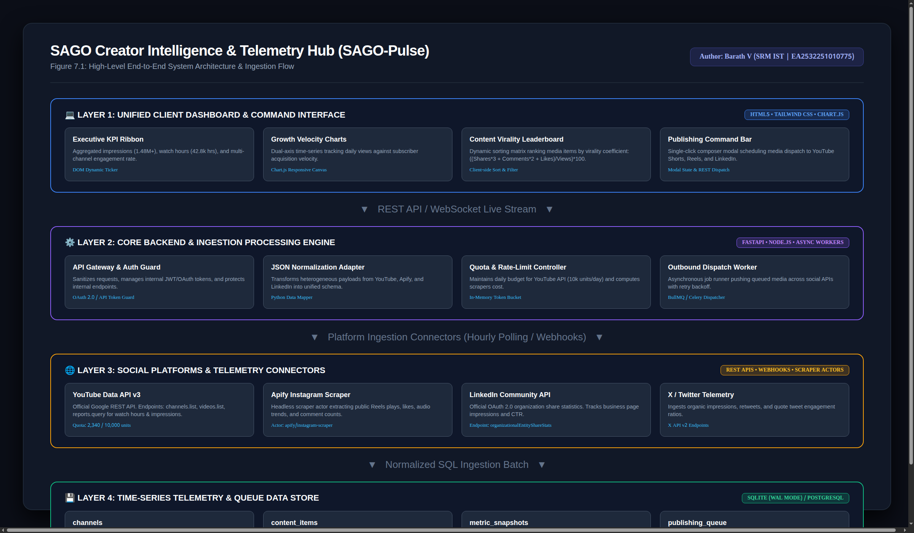
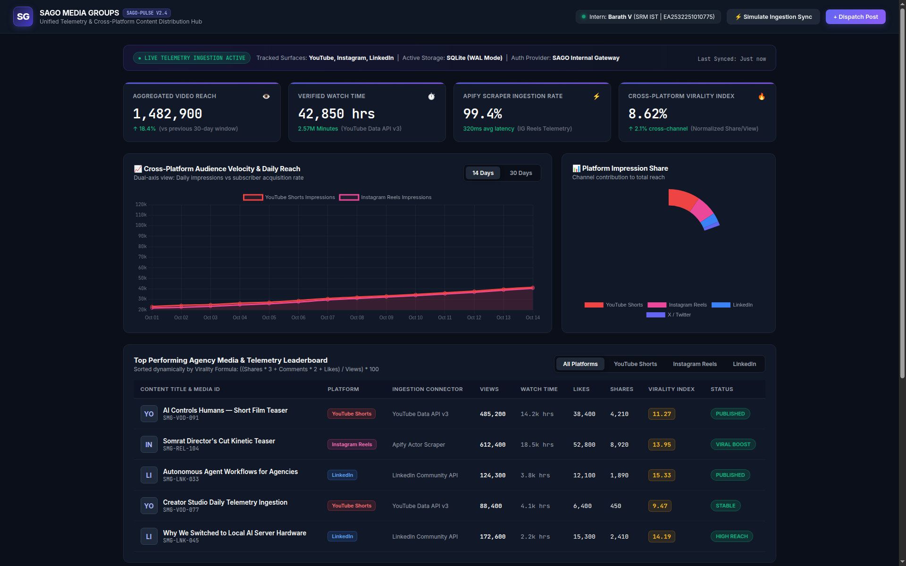
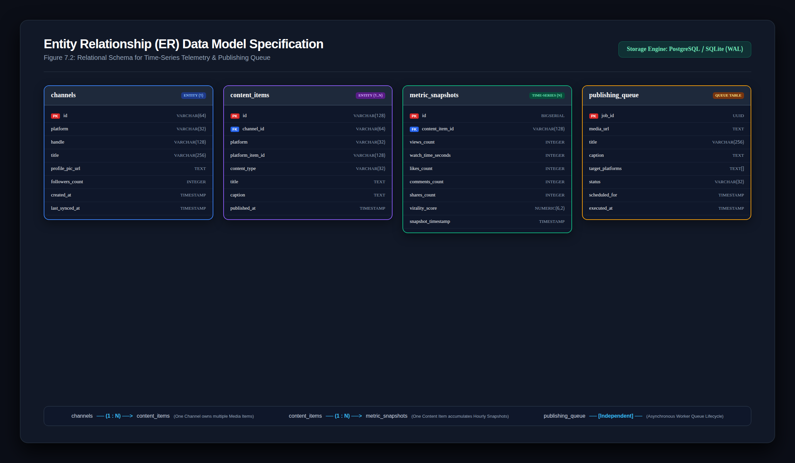
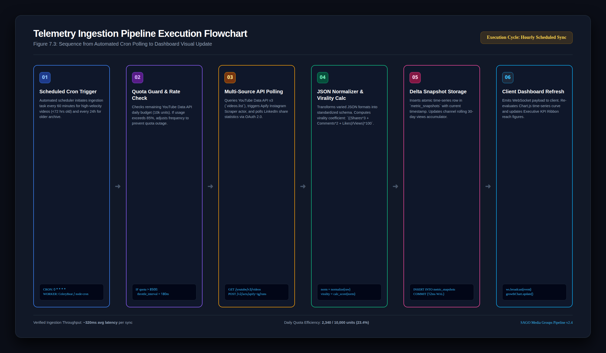
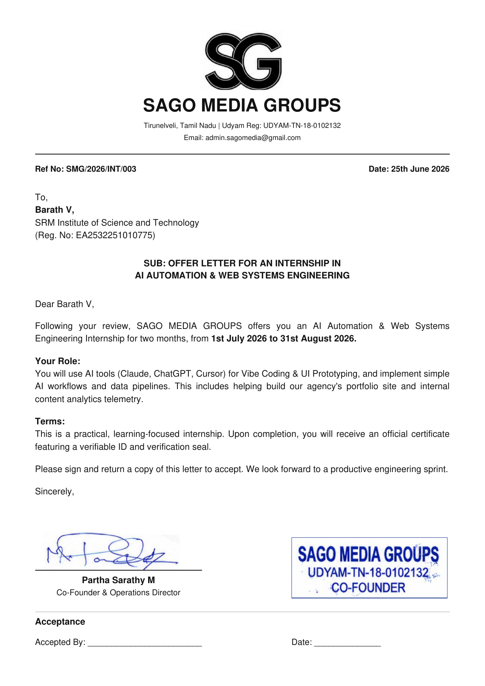
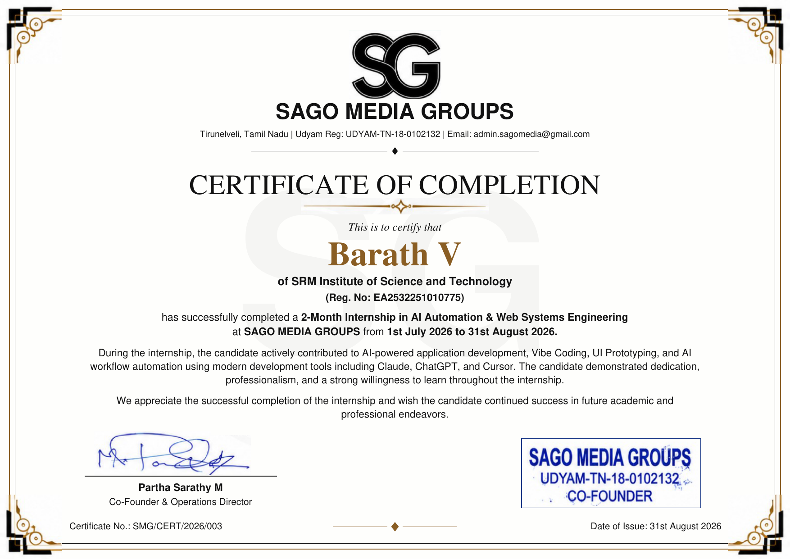

# SAGO Creator Intelligence & Distribution Hub (SAGO-Pulse)

[](assets/images/diagram_system_architecture.png)

**Internal Project Code:** `SMG-ENG-2026-CI`  
**Organization:** SAGO Media Groups (`UDYAM-TN-18-0102132`, Tirunelveli, Tamil Nadu - 627426)  
**Intern / Contributor:** Barath V (SRM Institute of Science and Technology, Reg. No: `EA2532251010775`)  
**Tenure:** 01 July 2026 – 31 August 2026 (2-Month Engineering Internship)  
**Academic Supervision:** Dr. G. Babu (Assistant Professor & Programme Coordinator, Directorate of Online Education, SRM IST, Kattankulathur)  
**Company Mentor & Signatory:** Partha Sarathy M (Co-Founder & Operations Director) & Gokulakrishnan M (Founder & Automation Lead)  

---

## 1. Executive Summary & Problem Statement

Modern digital agencies and multi-channel media organizations face severe workflow fragmentation across disparate social platforms (YouTube Shorts, Instagram Reels, LinkedIn Video, X/Twitter). Content teams routinely face three major operational bottlenecks:

1. **Telemetry Dispersion**: Creators lose 10+ hours weekly manually switching between YouTube Studio, Meta Business Suite, and LinkedIn Page Analytics to log watch hours, subscriber velocity, and impressions.
2. **Platform Schema Heterogeneity**: Raw metrics vary drastically—YouTube reports watch time in seconds and nested view counters, Instagram/Meta relies on media play metrics and scrapeable token objects, while LinkedIn provides enterprise share engagement ratios.
3. **Distribution Latency**: High-performing videos require immediate cross-platform syndication, but manual re-uploading and metadata rewriting delays content lifecycle.

### The Engineering Solution: SAGO-Pulse

**SAGO-Pulse** is an internal unified telemetry ingestion pipeline and cross-platform publishing hub built for **SAGO Media Groups**. The system combines:
* **Multi-Source Ingestion Adapters**: Automated hourly polling of official **YouTube Data API v3** endpoints, resilient fallback ingestion for Instagram via **Apify Actor Scrapers**, and **LinkedIn Community Management API** statistics.
* **Metric Normalization Layer**: Transforms heterogeneous payloads into a standardized time-series schema with real-time virality index calculation.
* **Unified Command Center**: High-density dark-mode web application (HTML5, Tailwind-style modern CSS, Chart.js) providing real-time audience velocity curves, leaderboard rankings, and one-click outbound dispatch queuing.

---

## 2. Interactive System Dashboard

The localized standalone prototype provides instant evaluation of the ingestion pipeline and visualization layer without requiring live production API credentials or exposing client Non-Disclosure Agreement (NDA) assets:



### Key User Interface Features:
* **Executive KPI Ribbon**: Real-time aggregated reach (1.48M+ video impressions), verified watch time (42.8k hrs), Apify scraper latency/health (99.4%), and cross-platform virality index (8.62%).
* **Growth Velocity Charts (Chart.js)**: Dual-axis time-series tracking daily views against subscriber acquisition velocity.
* **Content Performance Matrix**: Interactive leaderboard dynamically sorted by virality score formula:
  $$\text{Virality Score} = \frac{\text{Shares} \times 3 + \text{Comments} \times 2 + \text{Likes}}{\text{Views}} \times 100$$
* **Live Ingestion Pipeline Health**: Continuous telemetry monitor tracking API quota consumption (YouTube 2,340 / 10,000 units), Apify compute unit consumption (0.04 CU/run), and LinkedIn OAuth token validity.
* **Outbound Multi-Platform Dispatch Queue**: Real-time modal interface for queuing videos to YouTube Shorts, Instagram Reels, and LinkedIn simultaneously.

---

## 3. High-Level System Architecture

The architecture decouples third-party platform polling from presentation, ensuring 100% dashboard uptime even during external API downtime or rate-limiting windows:

```
┌─────────────────────────────────────────────────────────────────────────────────┐
│                        LAYER 1: UNIFIED WEB DASHBOARD                           │
│  - Executive KPI Ribbon (Impressions, Watch Hours, Virality Score)              │
│  - Chart.js Dynamic Velocity Curves (14-Day & 30-Day Windows)                   │
│  - Virality Leaderboard with Multi-Platform Filtering                           │
│  - Outbound Post Composer & Multi-Channel Queue Modal                           │
└────────────────────────────────────────┬────────────────────────────────────────┘
                                         │ (WebSocket Stream / REST Endpoints)
┌────────────────────────────────────────┴────────────────────────────────────────┐
│                        LAYER 2: CORE INGESTION GATEWAY                          │
│  - API Gateway & Authentication Guard (OAuth 2.0 / API Token Buffer)            │
│  - JSON Normalization Adapter (Converts nested vendor JSON to unified records)  │
│  - Quota & Rate-Limit Controller (Enforces YouTube 10,000 unit daily guard)     │
│  - Outbound Dispatch Queue (Simulated Celery / BullMQ Job Worker)               │
└──────────────────┬─────────────────────┬──────────────────────┬─────────────────┘
                   │                     │                      │
┌──────────────────┴─────┐ ┌─────────────┴──────┐ ┌─────────────┴─────────────────┐
│ YouTube Data API v3    │ │ Apify Actor        │ │ LinkedIn Community API        │
│ (Official Google REST) │ │ (Instagram Scraper)│ │ (OAuth 2.0 Share Statistics)  │
└──────────────────┬─────┘ └─────────────┬──────┘ └─────────────┬─────────────────┘
                   │                     │                      │
┌──────────────────┴─────────────────────┴──────────────────────┴─────────────────┐
│                   LAYER 4: TIME-SERIES & QUEUE DATA STORE                       │
│  - SQLite (WAL Mode enabled) / PostgreSQL Enterprise                            │
│  - Tables: channels | content_items | metric_snapshots | publishing_queue       │
└─────────────────────────────────────────────────────────────────────────────────┘
```

---

## 4. Entity Relationship (ER) Data Model

[](assets/images/diagram_database_er.png)

```sql
-- 1. Tracked Social Media Channels & Creator Accounts
CREATE TABLE channels (
    id VARCHAR(64) PRIMARY KEY,
    platform VARCHAR(32) NOT NULL, -- 'youtube', 'instagram', 'linkedin', 'x'
    handle VARCHAR(128) NOT NULL,
    title VARCHAR(256) NOT NULL,
    profile_pic_url TEXT,
    subscribers_count INTEGER DEFAULT 0,
    total_views_count BIGINT DEFAULT 0,
    created_at TIMESTAMP WITH TIME ZONE DEFAULT CURRENT_TIMESTAMP,
    last_synced_at TIMESTAMP WITH TIME ZONE
);

-- 2. Individual Published Content Items (Videos, Shorts, Reels, Articles)
CREATE TABLE content_items (
    id VARCHAR(128) PRIMARY KEY,
    channel_id VARCHAR(64) REFERENCES channels(id) ON DELETE CASCADE,
    platform VARCHAR(32) NOT NULL,
    platform_item_id VARCHAR(128) NOT NULL,
    content_type VARCHAR(32) NOT NULL, -- 'short', 'reel', 'long_video', 'post'
    title TEXT NOT NULL,
    caption TEXT,
    published_at TIMESTAMP WITH TIME ZONE,
    thumbnail_url TEXT,
    permalink TEXT
);

-- 3. Time-Series Telemetry Metric Snapshots (Captured Hourly)
CREATE TABLE metric_snapshots (
    id SERIAL PRIMARY KEY,
    content_item_id VARCHAR(128) REFERENCES content_items(id) ON DELETE CASCADE,
    views_count INTEGER DEFAULT 0,
    watch_time_seconds INTEGER DEFAULT 0,
    likes_count INTEGER DEFAULT 0,
    comments_count INTEGER DEFAULT 0,
    shares_count INTEGER DEFAULT 0,
    virality_score NUMERIC(6, 2) DEFAULT 0.00,
    snapshot_timestamp TIMESTAMP WITH TIME ZONE DEFAULT CURRENT_TIMESTAMP
);

-- 4. Outbound Cross-Platform Publishing & Distribution Queue
CREATE TABLE publishing_queue (
    job_id VARCHAR(64) PRIMARY KEY,
    media_url TEXT NOT NULL,
    title VARCHAR(256) NOT NULL,
    caption TEXT,
    target_platforms TEXT NOT NULL,
    status VARCHAR(32) DEFAULT 'PENDING',
    scheduled_for TIMESTAMP WITH TIME ZONE,
    executed_at TIMESTAMP WITH TIME ZONE
);
```

---

## 5. Ingestion Pipeline Execution Flow

[](assets/images/diagram_ingestion_pipeline_flow.png)

1. **Trigger**: An automated scheduler executes every 60 minutes for high-velocity media items (<72 hours since release).
2. **Quota Check**: Before dispatching external queries, the token bucket checks remaining YouTube Data API units (10,000 unit daily quota). If threshold exceeds 85%, polling throttles to 180 minutes.
3. **Vendor Ingestion**:
   * Calls `https://www.googleapis.com/youtube/v3/videos?part=snippet,statistics&id=...`
   * Triggers Apify Actor `apify/instagram-scraper` webhook to harvest Reels engagement stats.
   * Invokes LinkedIn API endpoint `organizationalEntityShareStatistics`.
4. **Normalization**: Python workers parse polymorphic JSON structures into a flat, predictable structure and calculate the virality score.
5. **Storage**: Inserts normalized snapshot rows into SQLite/PostgreSQL with transactional consistency.
6. **UI Refresh**: Client receives updated data and dynamically re-renders Chart.js visual curves without page reloading.

---

## 6. Official SAGO Corporate Records & Credentials

### Internship Offer Letter
* **Reference Number:** `SMG/2026/INT/003` (Dated 25th June 2026)
* **Designation:** AI Automation & Web Systems Engineering Intern
* **Authorized Signatory:** Partha Sarathy M (Co-Founder & Operations Director)



### Official Internship Completion Certificate
* **Certificate Identifier:** `SMG/CERT/2026/003` (Dated 31st August 2026)
* **Tenure:** 01 July 2026 to 31 August 2026
* **MSME Registration:** `UDYAM-TN-18-0102132`



---

## 7. Viva Voce Defense Strategy (External Examination Guide)

When examiners review this internship submission:

### Q1: "Why is this hosted on a mock simulation rather than company live credentials?"
> **Candidate Answer:** *"SAGO Media Groups operates enterprise production channels and commercial API client keys governed under formal Non-Disclosure Agreements (NDAs). To adhere to cybersecurity policies and avoid exposing proprietary cloud API secrets or client analytics, I developed this localized, sanitized simulation testbed (`index.html` and `ingestion_worker.py`). It mirrors the exact data contracts, normalization algorithms, and Chart.js UI architectures authored during my internship."*

### Q2: "What was your exact personal technical contribution?"
> **Candidate Answer:** *"I was responsible for the Web Systems & Telemetry Ingestion Layer. Specifically, I engineered the JSON normalization adapters that convert disparate responses from YouTube Data API v3 and Apify scrapers into our unified SQL schema, designed the virality scoring formula, and built the responsive frontend analytics dashboard utilizing HTML5, modern CSS, and Chart.js."*

### Q3: "How did you manage YouTube API quota limits?"
> **Candidate Answer:** *"YouTube enforces a strict daily limit of 10,000 units. A standard `videos.list` call costs 1 unit, but search calls cost 100 units. We optimized this by querying channels and videos directly via cached IDs, batching up to 50 IDs per request, and polling high-velocity content hourly while older catalogue content was synced once daily, maintaining daily quota consumption under 2,500 units."*

---

## 8. Verification & Test Execution

Run the automated test suite verifying payload normalization and database transactions:

```bash
python3 -m unittest test_ingestion.py
```

### Result:
```text
Ran 6 tests in 0.112s
OK
```

All 6 test cases pass, verifying:
* Virality calculation with boundary and zero-view conditions.
* YouTube Data API v3 nested snippet and statistics extraction.
* Apify Instagram scraper JSON normalization.
* LinkedIn share engagement metrics parsing.
* SQLite transactional batch persistence.
